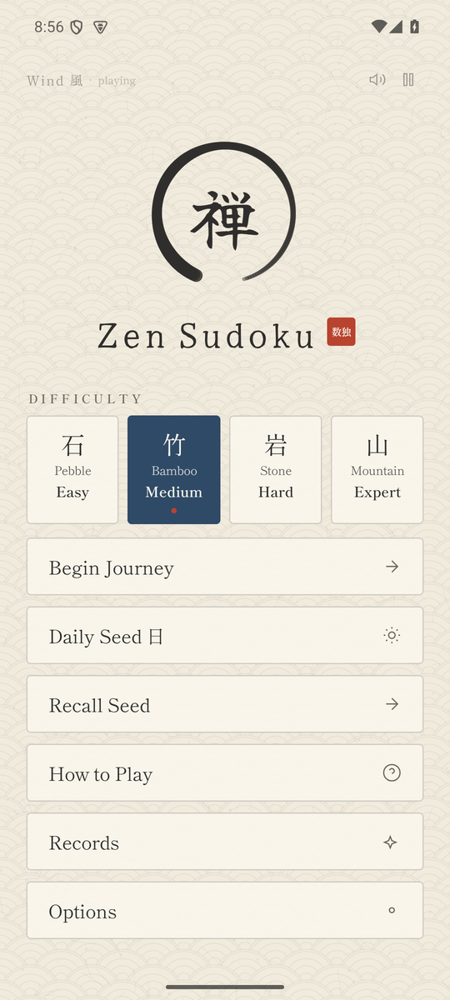

# Zen Sudoku

A calm, offline sudoku for Android: washi paper, sumi ink and quiet ambient music. No accounts, no network, no ads.



## Features

- Four levels: Pebble 石 (Easy), Bamboo 竹 (Medium), Stone 岩 (Hard), Mountain 山 (Expert).
- 8-character seeds: share a seed or recall one to play the same board. Seeds match the web version.
- Daily Seed 日, the same puzzle for everyone each day, with a quiet streak.
- Cell-first or digit-first input, up to four notes per cell, and notes that tidy themselves.
- Gentle guidance you can turn off: greyed impossible digits, possibility dots, a clarity border on cells with one answer, and Bloom to fill them.
- Hint lantern, undo, and a mistake limit of 3, 5 or none.
- Pause veil, resume after leaving, and an ensō with a hanko time stamp when you finish.
- Records: best and average per level, games played, and the longest daily streak.
- Themes Washi, Yoru, Sabi and Koke, with optional sakura or momiji accents.
- Calm mode, soft haptics, larger digits and a left-handed pad.

## Build

```
gradle :app:assembleRelease
```

Release signing reads `SIGNING_STORE_FILE`, `SIGNING_STORE_PASSWORD`, `SIGNING_KEY_ALIAS` and `SIGNING_KEY_PASSWORD` from the environment. No keystore is kept in this repository.

## Credits

- Music (`audio/`): to swap a track, replace its file; the playlist is the `Tracks` list in `Audio.kt`.
  - Spirit: "Night Spirits", Stuart's own track, made with Suno (28 Dec 2025).
  - Earth: "Bamboo Forest", Stuart's own track, made with Suno.
  - Wind, Water: **placeholders** supplied by the owner.
  - Ether: **placeholder** made by Rivet.
- Fonts: Shippori Mincho, Yuji Syuku and JetBrains Mono, all under the SIL Open Font License (see `licenses/`).
